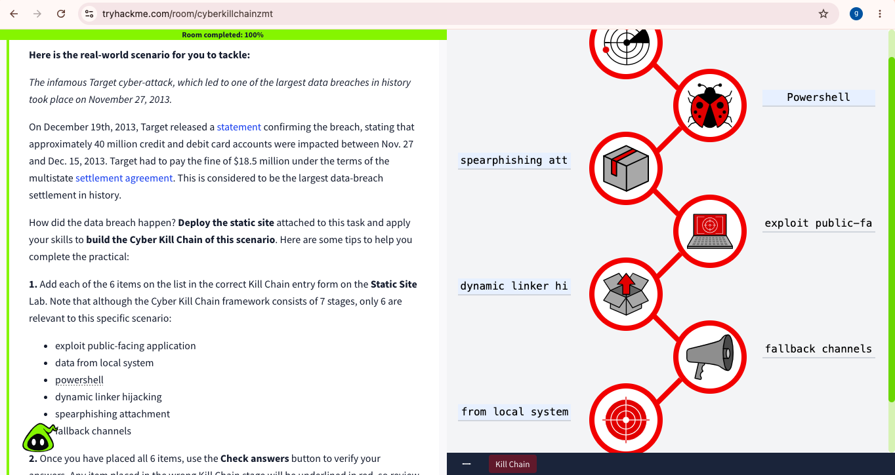

# Cyber Kill Chain Analysis: Target Data Breach Case Study

## Project Overview

This project explores the Cyber Kill Chain framework using a TryHackMe practical based on the 2013 Target data breach scenario.

The goal is to understand how different attack techniques relate to stages of a cyberattack and how defenders can detect, prevent, or disrupt malicious activity.

This is a beginner cybersecurity portfolio project documenting my learning journey in threat analysis and defensive security.

## Project Objectives

- Understand the Cyber Kill Chain framework.
- Map attack techniques to their relevant stages.
- Explore common attacker behaviours.
- Identify defensive controls for each stage.
- Practise documenting cybersecurity findings clearly.

## Tools and Resources

- TryHackMe — Cyber Kill Chain room
- Cyber Kill Chain framework
- Web browser
- GitHub for project documentation

## Lab Scenario

The practical uses the 2013 Target data breach as a real-world case-study context. The exercise asks learners to map six supplied techniques to the relevant stages of the Cyber Kill Chain.

The framework helps security analysts organize attack activity and identify opportunities to prevent or detect an intrusion.

## Technique Mapping

| Kill Chain Stage | Technique | Security Significance |
|---|---|---|
| Reconnaissance | Not used in this lab scenario | The exercise specifies that this stage is not relevant to its six supplied techniques. |
| Weaponization | PowerShell | A legitimate scripting tool that can also be abused to execute malicious commands or scripts. |
| Delivery | Spearphishing attachment | An attachment may be used to deliver a malicious payload or trick a user into opening it. |
| Exploitation | Exploit public-facing application | An exposed application may be targeted through a vulnerability or insecure configuration. |
| Installation | Dynamic linker hijacking | An attacker may abuse library-loading mechanisms to load an unintended or malicious library. |
| Command and Control | Fallback channels | Alternative communication channels may help malware maintain contact with attacker-controlled infrastructure. |
| Actions on Objectives | Data from local system | Collecting local data may support an attacker’s objective, such as preparing information for theft. |

**Important learning note:** These mappings represent the labels used in the lab exercise. In real investigations, techniques may support different stages depending on context. PowerShell is a dual-use tool, so its presence alone does not establish malicious activity.
## Lab Evidence

Successfully completed the TryHackMe Cyber Kill Chain practical.

## Methodology

1. Reviewed the TryHackMe scenario and instructions.
2. Identified the six techniques supplied by the exercise.
3. Mapped each technique to the relevant Cyber Kill Chain stage.
4. Used the lab's answer checker to validate the matches.
5. Considered defensive measures that could help detect or disrupt the activity.

## Defensive Recommendations

### 1. Email Security
- Filter suspicious emails and attachments.
- Use attachment sandboxing and endpoint protection.
- Educate users about spearphishing.

### 2. Application Security
- Patch vulnerable public-facing applications.
- Remove unnecessary internet-facing services.
- Monitor application logs for suspicious requests.

### 3. PowerShell Monitoring
- Monitor suspicious PowerShell commands and script execution.
- Enable appropriate script logging and endpoint detection.
- Apply least privilege and application controls where appropriate.

### 4. Installation and Persistence Detection
- Monitor unexpected library loads and changes to executable or library search paths.
- Restrict write access to sensitive system directories.
- Investigate unusual program behaviour.

### 5. Command and Control Detection
- Monitor unusual outbound network connections and DNS activity.
- Apply appropriate egress filtering.
- Investigate unexpected communication with unfamiliar destinations.

### 6. Data Protection
- Restrict access to sensitive information.
- Monitor unusual data access and bulk collection.
- Segment networks and alert on suspicious data transfers.

## Key Takeaways

- The Cyber Kill Chain provides a structured way to describe attacker activity.
- Security controls at multiple stages can reduce the likelihood and impact of a breach.
- Investigators should use context and multiple sources of evidence instead of relying on a single indicator.
- Clear documentation helps communicate findings and defensive recommendations.

## Skills Demonstrated

- Cyber Kill Chain analysis
- Basic threat analysis
- Security awareness
- Defensive security thinking
- Technical documentation
- Hands-on cybersecurity learning with TryHackMe

## Scope and Ethics

This project documents an authorized educational lab. All practical activities should remain within approved environments. No credentials, sensitive data, or exploit code are included in this repository.

## References

- [TryHackMe — Cyber Kill Chain](https://tryhackme.com/room/cyberkillchainzmt)
- [Lockheed Martin — Cyber Kill Chain](https://www.lockheedmartin.com/en-us/capabilities/cyber/cyber-kill-chain.html)
- Target's public statements and official reporting concerning the 2013 data breach.

---

**Author:** Wunmi Adam      
**Project:** Cyber Kill Chain Analysis  
**Focus:** Cybersecurity | Threat Analysis | Defensive Security
